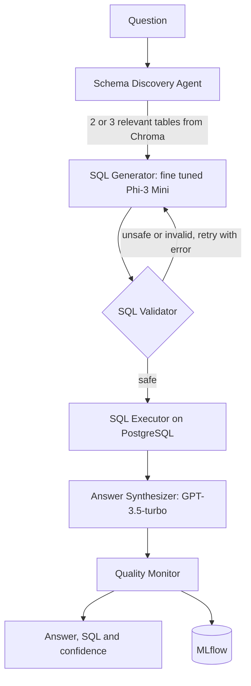

# QueryCraft Enterprise

[](https://github.com/Siddhesh-Ai9797/querycraft-enterprise/actions/workflows/ci.yml)

A multi agent text to SQL platform. Ask a question about a music store database in plain English, and five agents find the right tables, write the SQL, check it is safe, run it on PostgreSQL, and answer in a sentence with a confidence score. SQL comes from my own fine tuned Phi-3 Mini model, and every answer is scored and logged to MLflow.

**Live demo:** http://ec2-13-220-173-253.compute-1.amazonaws.com:8000/docs

```
POST /query
{"question": "Which artist has the most albums?"}

{"answer": "Iron Maiden has the most albums.", "confidence": 1.0, "sql": "SELECT ..."}
```

## Results

| Metric | Value |
|---|---|
| Fine tuned SQL model, exact match | **82%**, up from 0% for the base model |
| RAGAS answer relevancy | **0.971**, close to GPT-3.5-turbo at 0.976 |
| Cost per 1,000 queries | **$0.40**, 2.7x cheaper than GPT-3.5-turbo |
| AWS load test | 374 requests, **0 failures**, p95 2.0s |
| MLflow | 63+ logged runs |

### RAGAS evaluation on 30 stratified queries

| System | Cost per 1K queries | Answer relevancy | Faithfulness |
|---|---|---|---|
| **QueryCraft Enterprise** | **$0.40** | **0.971** | 0.071 |
| GPT-3.5-turbo | $1.07 | 0.976 | 0.036 |
| GPT-4o | $5.32 | 0.941 | 0.033 |

### Load test on AWS EC2, Locust with 5 users for 3 minutes

| p50 | p95 | p99 | Requests | Failures |
|---|---|---|---|---|
| 1.2s | 2.0s | 7.5s | 374 | 0% |

## How it works



1. **Find the tables.** Table schemas are embedded once with all-MiniLM-L6-v2 and cached in Chroma. Each question pulls back only the 2 or 3 tables it needs out of 11, which keeps the prompt short.
2. **Write the SQL.** The fine tuned Phi-3 Mini from [QueryCraft](https://github.com/Siddhesh-Ai9797/querycraft) turns the question and schema into SQL.
3. **Check it.** Three layers guard the database. Only SELECT statements pass. A blocklist rejects words like DROP, DELETE and UPDATE anywhere in the query. Then PostgreSQL EXPLAIN confirms the query is valid without running it.
4. **Retry.** If validation fails, the error goes back to the generator for up to 2 attempts.
5. **Answer.** The query runs on the Chinook database, and GPT-3.5-turbo turns the rows into a plain answer.
6. **Score.** A quality score combines model confidence, how complete the result looks, and query complexity. Answers under 0.6 are flagged, and everything is logged to MLflow and shown on a Streamlit dashboard.

The SQL generator has two backends. Locally it runs the fine tuned Phi-3 Mini on a GPU. The AWS deployment runs on a CPU instance, so it sets `INFERENCE_BACKEND=openai` and generates SQL with GPT-3.5-turbo through the same pipeline.

## Design decisions

Each choice is written up in `docs/adrs/`:

| Decision | Why |
|---|---|
| Phi-3 Mini 3.8B for SQL | Small enough to fine tune with QLoRA on one GPU, and accurate once tuned |
| Chroma for the schema cache | Persists between restarts, so schemas are embedded only once |
| PostgreSQL EXPLAIN for validation | The database itself checks the query, which catches more than regex rules |
| GPT-3.5-turbo for answers | Good enough to phrase results, at a fraction of GPT-4o's cost |
| LangChain LCEL over LangGraph | The pipeline is mostly a straight line, with one retry loop in plain Python |

## Known failure modes

`docs/failure-modes.md` covers what goes wrong and what I did about it:

* **Revenue questions with 4 or more joins** failed in 3 of 20 batch tests, because training data has mostly one or two table queries. Retrying with the error fixes about 40%.
* **Double quoted strings** like `name = "Iron Maiden"` fail in PostgreSQL. The adapter rewrites them, so this is fully fixed.
* **OpenAI rate limits** caused the 7.5s p99 in the load test. Backoff in the answer agent helps.
* **Stale schema cache** after a migration needs a manual refresh for now.

## Tech stack

| Area | Tools |
|---|---|
| Models | Phi-3 Mini 3.8B with QLoRA, GPT-3.5-turbo |
| Orchestration | LangChain LCEL |
| Retrieval | Chroma, sentence-transformers |
| Database | PostgreSQL, SQLAlchemy |
| Evaluation | RAGAS, Locust |
| Serving | FastAPI, Docker, AWS ECR and EC2 |
| Monitoring | MLflow, Streamlit |

## Project structure

```
agents/
  schema_discovery.py     Picks relevant tables with Chroma
  sql_validator.py        SELECT only, blocklist and EXPLAIN checks
  sql_executor.py         Runs SQL on PostgreSQL
  answer_synthesizer.py   Turns rows into a sentence
core/
  pipeline.py             Chains the agents with a retry loop
  querycraft_adapter.py   Fine tuned Phi-3 Mini backend
  production_adapter.py   GPT-3.5-turbo backend for CPU hosts
  quality_monitor.py      Quality score and MLflow logging
evaluation/               RAGAS and batch evaluation
monitoring/dashboard.py   Streamlit dashboard
deploy/                   EC2 setup script
docs/                     Design decisions and failure modes
tests/                    Unit, database and load tests
main.py                   FastAPI app
```

## Running it

You need PostgreSQL with the [Chinook](https://github.com/lerocha/chinook-database) sample database and an OpenAI key.

```bash
pip install torch --index-url https://download.pytorch.org/whl/cu128
pip install -r requirements.txt
cp .env.example .env        # add DATABASE_URL and OPENAI_API_KEY
uvicorn main:app --port 8000
```

| Endpoint | Returns |
|---|---|
| `POST /query` | Answer, SQL, confidence and quality score |
| `GET /health` | Service status |
| `GET /metrics` | Recent quality metrics |

Or run it in Docker:

```bash
docker build -t querycraft-enterprise .
docker run -p 8000:8000 --env-file .env querycraft-enterprise
```

## Tests

```bash
pip install -r requirements-ci.txt
python -m pytest -q
```

The SQL safety tests always run. Database tests run when `DATABASE_URL` points at Chinook, and OpenAI tests run when `OPENAI_API_KEY` is set. GitHub Actions starts a Postgres database with Chinook on every push, so the validator, executor, schema and monitoring tests all run there.

## Related

* [QueryCraft](https://github.com/Siddhesh-Ai9797/querycraft): fine tuning and evaluation of the SQL model
* [Model on Hugging Face](https://huggingface.co/Sid9797/querycraft-phi3-sql): the published adapter weights

## Author

Siddhesh Patil, MS in Artificial Intelligence, DePaul University
